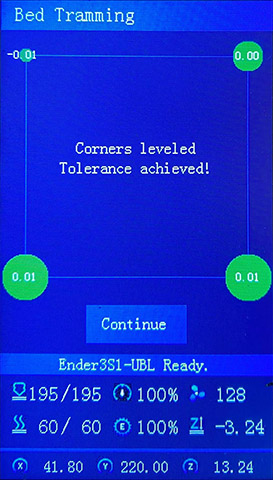

Step by Step guide 20240122 Ender3V2-422-BLTUBL-MPC
--------------------------------

Once you have installed your firmware, you can follow this guide.

1. Control -> Restore Defaults

2. Prepare -> Preheat (Pick your material)

	 wait until it reaches temperature

3. Tramming Wizard

4. Z Proble Wizard

	Back

	Back

	

	Advanced Store Settings

5. Auto Build Mesh

	Save

6. Advanced 

	MPC Settings

	MPC Autotune

	Back

	Store Settings

7. Advanced

	Bed PID Settings

	PID Autotune

	Back

	Store Settings

** In slicer settings update
<pre>
G28 ; Home all axes
G29 L0 ; load a valid mesh from slot 0
G29 A  ; activate the UBL system
</pre>

# Happy Printing
